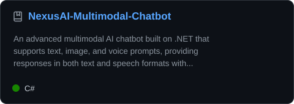
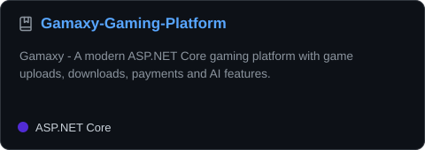
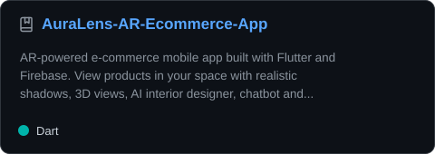
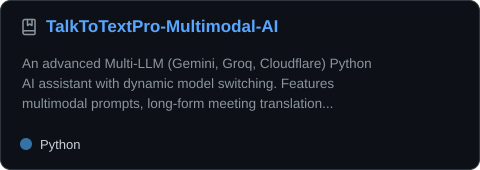
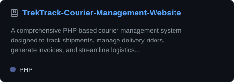
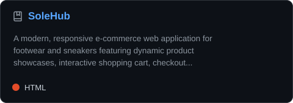

  

&nbsp;&nbsp;
&nbsp;&nbsp;
&nbsp;&nbsp;
&nbsp;&nbsp;
&nbsp;&nbsp;

 

 

<h2>&nbsp;About Me</h2>

&nbsp; Full-Stack Developer working with the **MERN stack, ASP.NET Core and Flutter** 
&nbsp; Building **AI-powered** web and mobile applications 
&nbsp; **Tech Olympic Season 2 Winner**, Generative AI Innovator of the Year (2025) 
&nbsp; Advanced Diploma in Software Engineering (Aptech), BS Computer Science (Ilma University) 
&nbsp; IT Instructor with experience teaching Web Development and Software Engineering 
&nbsp; Karachi, Pakistan

 

<h2>&nbsp;Tech Stack</h2>

 

<h2>&nbsp;What I Create</h2>

On **AhadProCoder** I share practical tutorials, coding projects, AI tools, web and mobile development, and real-world programming experiments.

| | Content |
|:---:|---|
|  | **AI Drawing Assistant**, a neural-network demo that recognizes what you draw |
|  | **Personal JARVIS**, a voice assistant that opens apps, searches Google and YouTube, and takes screenshots on command |
|  | **3D Particle Network**, an interactive visual built with JavaScript |
|  | **3D Web Navigation** using Three.js, HTML and CSS |

 

<h2>&nbsp;Find Me Everywhere</h2>

| | Platform | Link |
|:---:|:---:|:---:|
|  | YouTube | [AhadProCoder](https://www.youtube.com/channel/UC-mKVVdMC9VSakW0rL9sZ4w) |
|  | Instagram | [@ahadprocoder](https://www.instagram.com/ahadprocoder/) |
|  | Facebook | [AhadProCoder](https://www.facebook.com/AhadProCoder/) |
|  | TikTok | [@ahadprocoderdev](https://www.tiktok.com/@ahadprocoderdev) |
|  | LinkedIn | [ahadprocoder](https://linkedin.com/in/ahadprocoder) |
|  | Personal GitHub | [sidahad](https://github.com/sidahad) |

 

<h2>&nbsp;Featured Projects</h2>

<table>
<tr><td width="50%" align="center"></td><td width="50%" align="center"></td></tr>
<tr><td width="50%" align="center"></td><td width="50%" align="center"></td></tr>
<tr><td width="50%" align="center"></td><td width="50%" align="center"></td></tr>
</table>

 

| Project | Highlights | Links |
|---|---|:---:|
| NexusAI | Text, image and voice prompts, spoken replies, persistent chat history | [Repo](https://github.com/sidahad/NexusAI-Multimodal-Chatbot) |
| Gamaxy | 48 games, uploads and downloads, payments, AI chatbot | [Repo](https://github.com/sidahad/Gamaxy-Gaming-Platform) |
| AuraLens | AR product preview, 3D views, AI interior designer, admin dashboard | [Repo](https://github.com/sidahad/AuraLens-AR-Ecommerce-App) |
| TalkToTextPro | Gemini, Groq and Cloudflare model switching, meeting translation, PDF analytics | [Repo](https://github.com/sidahad/TalkToTextPro-Multimodal-AI) |
| Vehicle Insurance System | ASP.NET Core MVC with policy, claims, payment and customer management | [Repo](https://github.com/sidahad/Vehicle-Insurance-Management-System) |
| AhadTimezone E-Commerce | ASP.NET Core MVC with products, cart, orders and admin dashboard | [Repo](https://github.com/sidahad/AhadTimezone-ECommerce) |
| TrekTrack | Shipment tracking, rider management, invoices | [Repo](https://github.com/sidahad/TrekTrack-Courier-Management-Website) · [Live](https://trektrack.infinityfreeapp.com) |
| SoleHub | Animated, responsive e-commerce site | [Repo](https://github.com/sidahad/SoleHub) · [Live](https://solehub-7f40c.web.app/index.html) |

More projects on my personal profile: [github.com/sidahad](https://github.com/sidahad)

 

<h2>&nbsp;Contribution Activity</h2>

<picture>
  <source media="(prefers-color-scheme: dark)" srcset="https://raw.githubusercontent.com/AhadProCoder/AhadProCoder/output/github-snake-dark.svg">
  
</picture>

 

